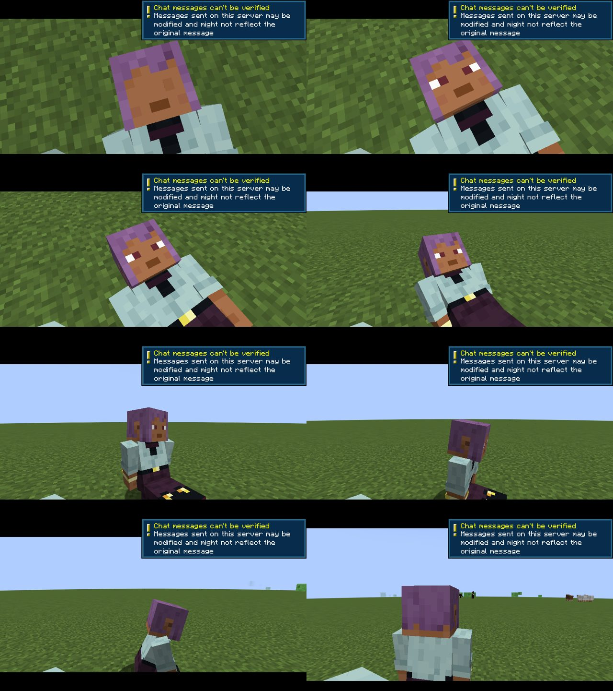

# Сцена пробуждения

Охотник лежит на земле, открывает глаза, поднимает голову, садится и встаёт. Сцена длится 8 секунд.

| Анимация | Время сцены | Что происходит |
|---|---|---|
| `awakening.lie` | 0–1.5 с | лежит на спине, дышит; экран медленно светлеет из чёрного |
| `awakening.open_eyes` | 1.5–2.5 с | веки поднимаются, моргание |
| `awakening.raise_head` | 2.5–3.5 с | голова поднимается к груди |
| `awakening.sit_up` | 3.5–5.5 с | садится, опираясь руками, оглядывается |
| `awakening.stand_up` | 5.5–8.0 с | наклон вперёд, встаёт, руки для равновесия |

Охотник видит сцену **от первого лица**: камера стоит в глазах модели и повторяет движение головы (те же ключевые кадры). Пока глаза закрыты, экран тёмный, с лёгким красноватым светом сквозь веки. Веки открываются с морганием, потом небо, поднятая голова, мир, пока он садится и встаёт. Свою голову он не видит, тело внизу видит. Остальные игроки видят его модель со стороны.

Сцена стартует, когда клиент сообщил серверу, что мир загружен (пакет «готов»), поэтому глаза открываются на готовый мир, а не на экран загрузки. До этого глаза закрыты, и мир не мелькает. С лаунчером Rift свет разлома тает прямо в темноту закрытых глаз.

Когда играет: один раз при первом входе в мир (`config/solostatus-server.toml` → `[awakening] introOnFirstJoin`) и по команде `/solostatus awaken <игроки>`.

## Версии

- **GeckoLib 4.9.3** для Minecraft 1.21.1 (ветка `1.21.1` репозитория https://github.com/bernie-g/geckolib, требует NeoForge 21.1.150+, у нас 21.1.228). Подключена только для компиляции (`compileOnly`) и объявлена в `neoforge.mods.toml` как необязательная (`[4.4,5)`). С Iron's Spells она уже стоит.
- Без GeckoLib сцена играет упрощённо: ванильная модель ложится и встаёт по тому же таймлайну, без век.
- GeckoLib 5 рассчитана на 1.21.5+ и сюда не подходит.

## Blockbench

Проекты: `art/blockbench/awakening_player_wide.bbmodel` (руки 4 px) и `awakening_player_slim.bbmodel` (3 px). Формат проекта — GeckoLib *Animated Entity*: для открытия нужен плагин **GeckoLib Animation Utils** (File → Plugins). В проекте есть тестовый скин `art/blockbench/test_skin.png` (свой, не скин Mojang).

Модель повторяет стандартную раскладку скина 64×64 (голова, тело, руки, ноги и второй слой: шляпа, куртка, рукава, штаны). Поэтому в игре её текстура — **скин самого игрока**, который Minecraft уже загрузил. Ничего не подменяется насовсем: модель существует только пока играет сцена.

Веки — кубики 2×1 px перед глазами (ряд 4 лица, как у стандартных скинов). Их текстура — ряд над глазами того же скина, поэтому они цвета кожи или бровей игрока.

### Как изменить анимацию

Источник правды — таблица ключевых кадров в `tools/blockbench/awakening.py`. Скрипт пишет и `.bbmodel`, и игровые файлы:

```
python3 tools/blockbench/awakening.py
```

- `src/main/resources/assets/solostatus/geo/awakening/player_{wide,slim}.geo.json`
- `src/main/resources/assets/solostatus/animations/awakening/player.animation.json`
- `art/blockbench/*.bbmodel`, `art/blockbench/test_skin.png`

Скрипт проверяет, что все анимированные кости есть в модели, что анимации стыкуются без рывков и что глаза к концу открыты. CI пересобирает файлы и падает, если они разошлись с таблицей.

Если удобнее править прямо в Blockbench: откройте `.bbmodel`, измените, затем File → Export → *Export GeckoLib Model* и *Export Animations* в те же пути. После этого перенесите кадры в таблицу скрипта, иначе CI попросит перегенерировать файлы.

Знаки поворотов в GeckoLib (проверено по исходникам `BakedAnimationsAdapter`): X и Y инвертируются. Поэтому `root X = −90` — лёжа на спине, `head X > 0` — подбородок к груди, `ноги X = −90` — ноги вперёд (сидя).

## Мультиплеер

```
сервер: AwakeningScene.start(игрок)
   ├─ всем игрокам в 96 блоках (и самому охотнику): пакет awakening(entityId, прошло=0)
   ├─ кто подошёл позже (PlayerEvent.StartTracking): пакет с прошедшим временем
   └─ через 8 с: конец сцены, уведомление Системы
клиент каждого зрителя: RenderPlayerEvent.Pre этого игрока → отменить ванильную модель,
                        нарисовать GeckoLib-модель со скином этого игрока (wide/slim по скину)
клиент самого охотника:  + вид от первого лица из глаз модели (mixin Camera.setup), своя голова не рисуется,
                        веки на экране по той же анимации век, управление заморожено, интерфейс скрыт;
                        конец — плавно в обычный вид от первого лица
```

- Сущность игрока не меняется: другие игроки, мобы и сервер видят обычного игрока, только рисуется он иначе.
- Опоздавший зритель начинает с текущей фазы (лежит / глаза / голова / садится / встаёт).
- Пока охотник лежит, у него Сопротивление V (8 с), чтобы сцена не стоила жизни.
- Проверено вторым игроком в сквозном тесте: он видит, как другой лежит, садится и встаёт.
- Модели строятся на клиенте; сервер шлёт два числа. Без GeckoLib на клиенте этот клиент видит упрощённую версию, у остальных всё как обычно.

## Как проверено

- **Сервер** (gametest в CI): сцена стартует, игрок защищён, сцена запоминается (играет один раз) и заканчивается.
- **Ресурсы**: CI пересобирает модель и анимации из таблицы и падает при расхождении; скрипт проверяет стыки анимаций.
- **Настоящий клиент** (Rift end-to-end: сервер NeoForge + клиент под Xvfb, с Epic Fight, Iron's Spells и GeckoLib с Modrinth):
  при первом входе игрок проходит сцену, клиент делает 11 кадров (`SOLO_E2E_SHOTS=1`), кадры публикуются в ветку `e2e-frames`.
  По кадрам проверено: лежит на спине лицом вверх, веки цвета кожи закрывают глаза и открываются, голова поднимается,
  садится с ногами вперёд, встаёт; камера облетает на расстоянии и возвращается в вид от первого лица.
  В логе: `Awakening: drawn with GeckoLib (slim model, skin minecraft:textures/entity/player/slim/efe.png)`, то есть модель
  получила стандартный скин игрока и slim-руки. С установленным Epic Fight сцена рисуется поверх его рендера.

Видео всей сцены с настоящего клиента, от первого лица, с переходом из разлома Rift (20 кадров/с): [images/awakening-e2e.mp4](images/awakening-e2e.mp4)

Как пробуждение другого игрока видят остальные: [images/awakening-other-e2e.mp4](images/awakening-other-e2e.mp4). В сквозном тесте (`SOLO_E2E_BOT=1` на сервере) после своей сцены перед игроком заходит второй игрок-бот и просыпается. Сервер шлёт сцену настоящему клиенту, как любому игроку рядом, а клиент рисует бота моделью сцены.



## Ограничения

- На модели сцены нет брони и предметов в руках: это короткая сцена «пробуждения», а не бой.
- Скины с нестандартным расположением глаз получат веки не точно на глазах.
- На оффлайн-сервере поверх сцены видно ванильное уведомление «Chat messages can't be verified»: это всплывающее окно Minecraft, а не слой интерфейса. На серверах с проверкой Microsoft его нет.
